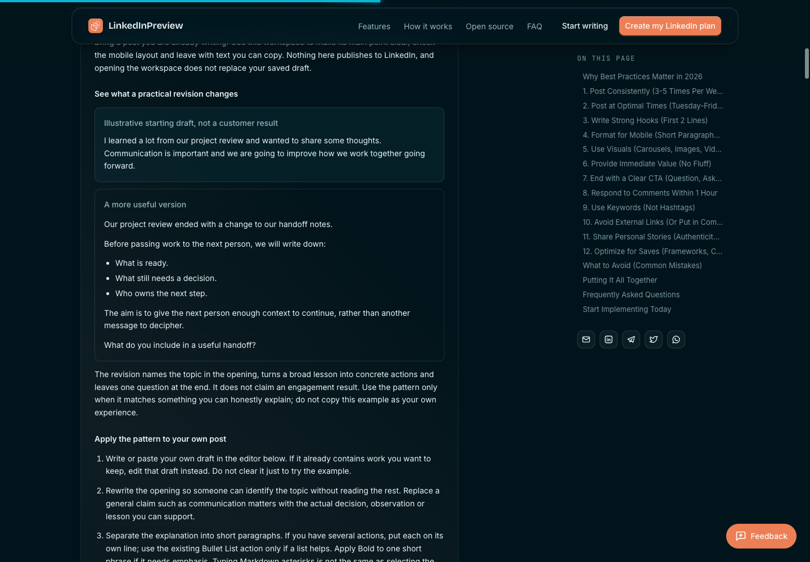
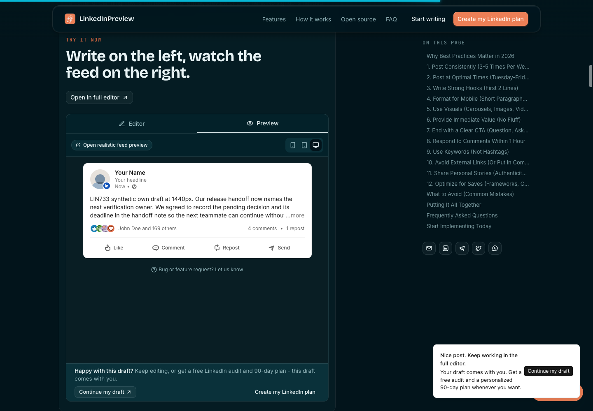
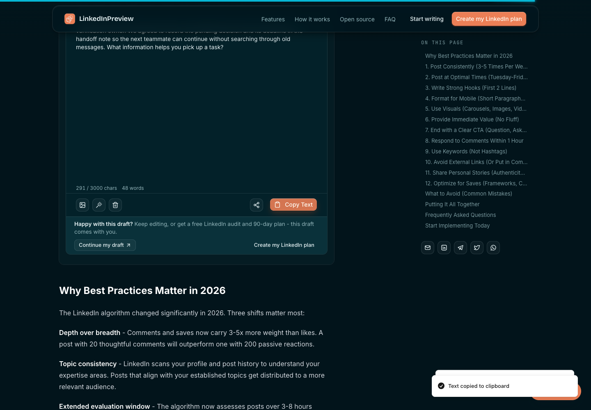
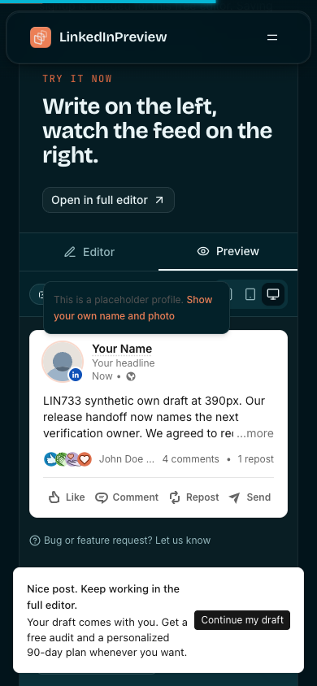
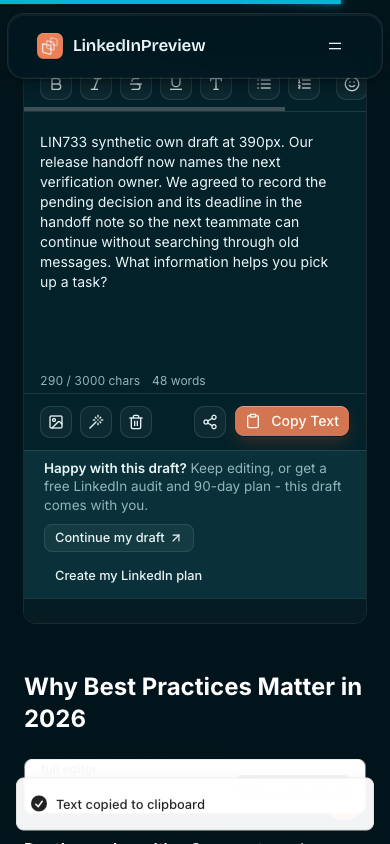
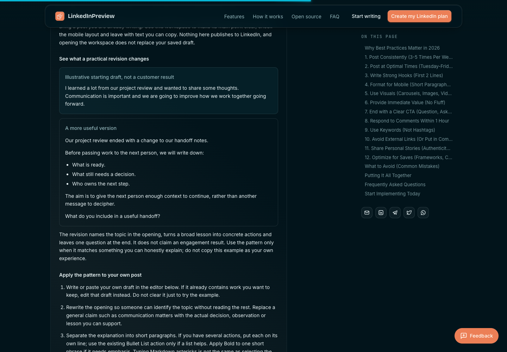
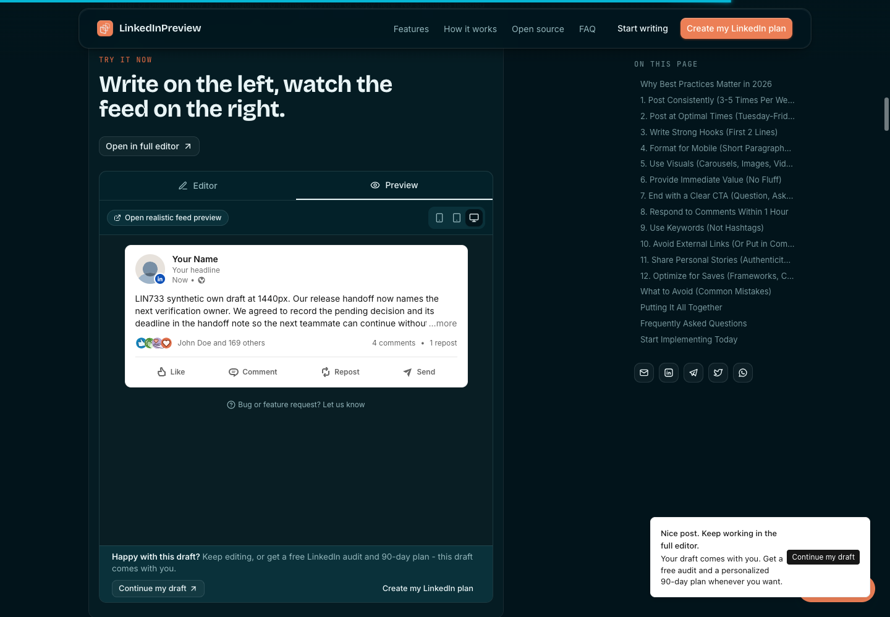
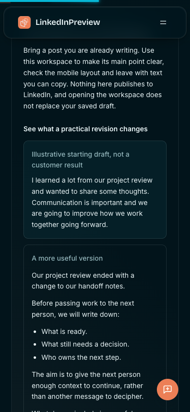

# LIN-733 preview screenshots

These screenshots were captured by Forge's contained browser run on the initial implementation READY preview, not production:

- Head: `0047f2d15fc9a04c691850c8fbe4b371c261b522`
- Preview: https://linkedinpreview-muk42wd94-gatteos.vercel.app
- 1440 x 1000 and 390 x 844 viewports.
- Native CDP input into real TipTap, useful own-draft revision, visible non-editor Preview and exact original browser clipboard readback passed on both widths.
- Repeated opening retained the same editor node and draft. Same-browser reload restored the exact local draft. All later card hrefs/modifier navigation retained; native final-card navigation reached the existing home tool with the same draft.
- Read-only worked example/checklist is separate from the draft; no sample controls or injection. Both rendered copies matched Ink's supplied copy after whitespace normalization (2625 characters).
- Supabase/API/provider/analytics/social transports were fixture-contained and blocked before every navigation. These are local-browser persistence and UI checks, not live backend durability, production acceptance or commercial outcomes.

Screenshots intentionally retain existing placeholder-profile tooltip, nudge and conversion UI. The preview's normal `...more` is a layout preview, not clipped editable content. No hidden editor toolbar overlaps the visible Preview.

This evidence predates the subsequent main rollback integration. Final-head READY URL, checks and repeated integration matrix are recorded in the PR handoff and Paperclip issue. Do not treat these initial-head images alone as final integration proof.

## Released-main integration screenshots

These additional images are from the exact READY preview at head `66f7613c74a9c027e5179a18a369ea4c073256ef`, integrated with released main `1ab6ef79bce7277f81803b9b0622b82031430d68`:

- Preview: https://linkedinpreview-l4r43ez0r-gatteos.vercel.app
- Deployment: `dpl_Fwv223HHqvws3GTbzhWSUuxRPwk5`, preview target, READY with matching Git source SHA.
- Both widths passed native own-draft editing, visible non-editor preview, exact original clipboard, same-node reopening, reload restoration and later-card native navigation. No captured application errors in either context.
- Backend/provider/telemetry transports remained synthetic-contained. No real customer write, payment or production acceptance is claimed.
- The subsequent evidence-only commit adds these images and captions, not product code. Its exact-head hosted regression receipt is linked in the PR and LIN-733 handoff. Earlier images and failures above remain historical, not final-head evidence.

